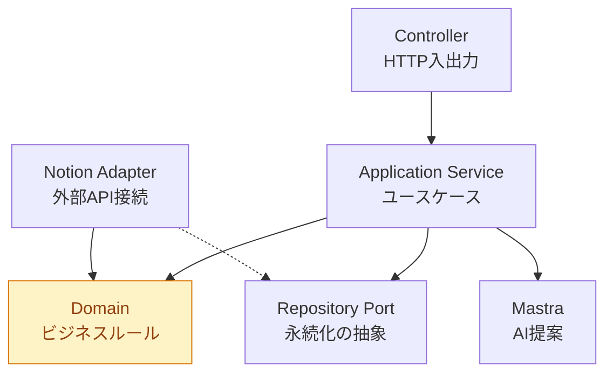

# 1. 依存方向の原則

- Controllerにビジネスロジックを書かない。
- DomainからNestJS・Notion・Mastraを直接呼ばない。
- 外部APIのレスポンスをドメインモデルとして直接使用しない。
- Mastraに確定データの保存権限を直接与えない。
- workspaceパッケージ間に循環依存を作らない。

# 2. TypeScript・スキーマ規則

| 規則          | 方針                         |
| ----------- | -------------------------- |
| `strict`    | 必須                         |
| `any`       | 原則禁止                       |
| `unknown`   | 外部入力に使用                    |
| Zod         | API入力・外部データの境界で検証          |
| TypeScript型 | Zodから推論できるものは重複定義しない       |
| Enum        | String literal unionを基本とする |
| 日時          | UTCのInstantとローカル日付を区別      |
| 金額・数値       | 単位を明示し、暗黙の変換を避ける           |

特にLifeBoardで重要なのは、実施日時と対象日を混同しないこと。
例えば、昨日の読書を今日登録しても、昨日の記録として残る必要がある。
このルールは全APIに適用。

# 3. テスト規則
テストは種類ごとに責務を明確にする。

| テスト         | 必須対象                         |
| ----------- | ---------------------------- |
| Unit        | 周期計算、集計、目標達成判定               |
| Schema      | 正常・異常入力、境界値                  |
| Mapper      | ドメインとNotionの往復変換             |
| Integration | NestJS ServiceとRepositoryの連携 |
| E2E         | Routine登録から実施記録までの主要フロー      |

すべての関数にテストを書く必要はない。
ただし、ビジネスルールを変更する場合は、必ず対応するテストを更新する。
また、外部サービスを使用するテストと、使用しないテストは分離する。
通常のCIでNotion APIやWorkers AIへ毎回アクセスする構成は避けたい。

# 3. さらに決めるべき開発ツール（現状案）

実装規則と同時に、品質チェックのツールも選定。

| 用途                 | 第一候補             | 補足                  |
| ------------------ | ---------------- | ------------------- |
| Package Manager    | pnpm             | 決定済み                |
| Runtime            | Node.js          | Workers互換性は別途検証     |
| Formatter / Linter | Biome            | 一元化候補               |
| Unit Test          | Vitest           | ドメイン単体テスト向け         |
| E2E Test           | Jest + Supertest | NestJSのHTTPテスト候補    |
| Git Hooks          | Lefthook         | pre-commit検証        |
| CI                 | GitHub Actions   | typecheck・lint・test |
| API Docs           | OpenAPI          | NestJSの契約可視化        |

ツールを増やすこと自体が目的にならないよう、まずは`lint`、`typecheck`、`test`の3コマンドが動く状態を目指す。

# 4. 私が特に重視したい3つの規則

① 不要な抽象化をしない。
RepositoryやMapperは必要な理由があるときだけ作る。1つのNotion API呼び出しを包むために5層のクラスを用意する必要はない。

② ビジネスルールをテストで保証する。
特に日次・週次の集計、日付境界、実施回数と実施日数の違いは、必ずテストする。ここが壊れるとLifeBoardの根幹が壊れる。

③ AIに判断と保存を一度に任せない。
AIは提案し、ドメインが検証し、利用者が承認し、アプリケーションが保存する。。
