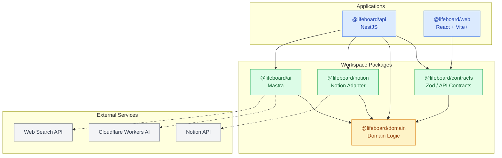

## LifeBoard ディレクトリ構成

```
lifeboard/
├── apps/
│   ├── api/                         # NestJS
│   │   ├── src/
│   │   │   ├── routines/
│   │   │   │   ├── routines.module.ts
│   │   │   │   ├── routines.controller.ts
│   │   │   │   └── routines.service.ts
│   │   │   │
│   │   │   ├── executions/
│   │   │   │   ├── executions.module.ts
│   │   │   │   ├── executions.controller.ts
│   │   │   │   └── executions.service.ts
│   │   │   │
│   │   │   ├── ai/
│   │   │   │   ├── ai.module.ts
│   │   │   │   └── ai.service.ts
│   │   │   │
│   │   │   ├── app.module.ts
│   │   │   └── main.ts
│   │   │
│   │   ├── test/
│   │   ├── package.json
│   │   └── tsconfig.json
│   │
│   └── web/                         # React + Vite+（後回し）
│
├── packages/
│   ├── domain/                      # 純粋なドメインロジック
│   │   └── src/
│   │       ├── routine/
│   │       │   ├── routine.ts
│   │       │   ├── schedule-rule.ts
│   │       │   └── target.ts
│   │       │
│   │       ├── execution/
│   │       │   ├── execution-record.ts
│   │       │   ├── measurement.ts
│   │       │   └── occurrence-outcome.ts
│   │       │
│   │       ├── evaluation/
│   │       │   ├── daily-summary.ts
│   │       │   ├── weekly-summary.ts
│   │       │   └── achievement.ts
│   │       │
│   │       └── index.ts
│   │
│   ├── contracts/                   # Zod / APIスキーマ
│   │   └── src/
│   │       ├── routines.ts
│   │       ├── executions.ts
│   │       └── index.ts
│   │
│   ├── notion/                      # Notion Adapter
│   │   └── src/
│   │       ├── schemas/
│   │       │   ├── routines.ts
│   │       │   └── activity-records.ts
│   │       ├── mappers/
│   │       │   ├── routine.mapper.ts
│   │       │   ├── execution.mapper.ts
│   │       │   └── outcome.mapper.ts
│   │       ├── repositories/
│   │       │   ├── notion-routine.repository.ts
│   │       │   └── notion-execution.repository.ts
│   │       └── index.ts
│   │
│   └── ai/                          # Mastra
│       └── src/
│           ├── agents/
│           │   └── knowledge.agent.ts
│           ├── tools/
│           │   └── web-search.tool.ts
│           ├── workflows/
│           │   └── routine-planning.workflow.ts
│           └── index.ts
│
├── docs/
│   ├── requirements/
│   │   ├── requirements.md          # 要件定義
│   │   └── decisions.md             # 決定・未決定事項
│   │
│   └── design/
│       ├── domain-model.md          # Mermaid classDiagram
│       ├── notion-mapping.md        # Notion物理モデル
│       ├── architecture.md          # 依存関係・構成図
│       └── sequences.md             # Mermaid sequenceDiagram
│
├── pnpm-workspace.yaml
├── package.json
├── pnpm-lock.yaml
├── tsconfig.base.json
└── README.md
```

## パッケージ間の依存関係




## pnpm-workspace.yaml

```
packages:
  - "apps/*"
  - "packages/*"
```

## パッケージ名の例

| ディレクトリ               | `package.json` の name  |
| -------------------- | ---------------------- |
| `apps/api`           | `@lifeboard/api`       |
| `apps/web`           | `@lifeboard/web`       |
| `packages/domain`    | `@lifeboard/domain`    |
| `packages/contracts` | `@lifeboard/contracts` |
| `packages/notion`    | `@lifeboard/notion`    |
| `packages/ai`        | `@lifeboard/ai`        |

内部依存には `workspace:*` を使用する。

例えば `apps/api/package.json` は次のようになる。

```
{
  "name": "@lifeboard/api",
  "private": true,
  "dependencies": {
    "@lifeboard/domain": "workspace:*",
    "@lifeboard/contracts": "workspace:*",
    "@lifeboard/notion": "workspace:*",
    "@lifeboard/ai": "workspace:*"
  }
}
```

実際にはNestJS関連の依存パッケージも追加する。
最初に作るのは `apps/api`、`packages/domain`、`packages/contracts`、`packages/notion` の4つで十分。
`packages/ai`はMastra導入時に、`apps/web`はフロントエンド開発時に追加する形でよい。


## 依存関係の設計原則

| パッケージ                  | 依存先                           | 役割                   |
| ---------------------- | ----------------------------- | -------------------- |
| `@lifeboard/api`       | domain, contracts, notion, ai | アプリケーションの組み立てとユースケース |
| `@lifeboard/web`       | contracts                     | API契約を共有             |
| `@lifeboard/contracts` | domain                        | APIの入力・出力スキーマ        |
| `@lifeboard/notion`    | domain                        | Notionへの永続化          |
| `@lifeboard/ai`        | domain                        | AIによる行動支援            |
| `@lifeboard/domain`    | なし                            | 純粋なドメインロジック          |

なお、これは設計上のパッケージ依存図であり、NestJSのDependency Injectionにおける実行時の依存関係とは別。DIの依存方向を逆転させる場合でも、物理的なimport関係と混同しないようにしたい。
`packages/domain`はNestJS・Notion・Mastraに依存させない。周期計算や実績集計は、外部サービスなしで単体テストできるようにする。
