## LifeBoard Issue構成案

```mermaid

flowchart TD
    ROOT["LifeBoard"]

    ROOT --> E0
    ROOT --> E1
    ROOT --> E2
    ROOT --> E3
    ROOT --> E4
    ROOT --> E5
    ROOT --> E6

    subgraph MVP["MVP：生活習慣管理API"]
        E0["Epic: 開発環境を構築する"]
        E0 --> I01["pnpm workspaceを構築する"]
        E0 --> I02["NestJSアプリケーションを初期化する"]
        E0 --> I03["Zodによる入力検証を導入する"]

        E1["Epic: Notion連携を実装する"]
        E1 --> I11["Notion APIクライアントを実装する"]
        E1 --> I12["Routine用データソースを定義する"]
        E1 --> I13["実施記録用データソースを定義する"]

        E2["Epic: Routine管理APIを実装する"]
        E2 --> I21["Routineのドメインスキーマを定義する"]
        E2 --> I22["Routine登録APIを実装する"]
        E2 --> I23["Routine一覧取得APIを実装する"]
        E2 --> I24["日次の実行予定算出を実装する"]

        E3["Epic: 実施記録APIを実装する"]
        E3 --> I31["ExecutionRecordのスキーマを定義する"]
        E3 --> I32["実施記録の登録APIを実装する"]
        E3 --> I33["日付別の実施記録取得APIを実装する"]
        E3 --> I34["日次の数値集計を実装する"]
    end

    subgraph EXT["MVP後の拡張"]
        E4["Epic: 定期タスク管理を拡張する"]
        E4 --> I41["曜日指定の周期計算を実装する"]
        E4 --> I42["週N回の実施判定を実装する"]
        E4 --> I43["スキップ・延期を実装する"]

        E5["Epic: MastraによるAI支援を実装する"]
        E5 --> I51["Workers AIとの接続を実装する"]
        E5 --> I52["自然言語から行動更新案を生成する"]
        E5 --> I53["Web検索による行動計画の提案を実装する"]
        E5 --> I54["AI提案の承認フローを実装する"]

        E6["Epic: Cloudflareへのデプロイを実現する"]
        E6 --> I61["NestJSのWorkers互換性を検証する"]
        E6 --> I62["Cloudflareへのデプロイ設定を実装する"]
    end

    classDef epic fill:#dbeafe,stroke:#2563eb,color:#1e40af
    classDef task fill:#f3f4f6,stroke:#9ca3af,color:#374151
    class E0,E1,E2,E3,E4,E5,E6 epic
    class I01,I02,I03,I11,I12,I13,I21,I22,I23,I24,I31,I32,I33,I34,I41,I42,I43,I51,I52,I53,I54,I61,I62 task

```

## Epic Issue一覧

| Epic | タイトル                  | フェーズ |
| ---- | --------------------- | ---- |
| #E0  | 開発環境を構築する             | MVP  |
| #E1  | Notion連携を実装する         | MVP  |
| #E2  | Routine管理APIを実装する     | MVP  |
| #E3  | 実施記録APIを実装する          | MVP  |
| #E4  | 定期タスク管理を拡張する          | MVP後 |
| #E5  | MastraによるAI支援を実装する    | MVP後 |
| #E6  | Cloudflareへのデプロイを実現する | MVP後 |

#E0〜#E6は仮の識別子であり、GitHubの実際のIssue番号ではない。

合計：7 Epic / 23 Sub Issues

今回の構成なら、まず E0 → E1 → E2 → E3 を進めれば、日次習慣の登録・予定取得・実施記録・数値集計ができるAPIになる。
なお、将来的なReact + Vite+のフロントエンドやNotion OAuthは、今回のIssueにはまだ入れていない。
実装を始める前からIssueが50件並んでいると、それ自体がLifeBoardで管理すべき生活上の問題になりかねない。
